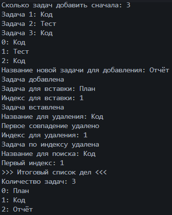

# Практическая работа №21 
Автор:  Белоярова Александра   
Группа: ИСП-251
## Тема 
Коллекция List в C#. 
## Что реализовано
 - ввод и вывод списка задач; 
 - добавление и вставка; 
 - удаление по значению и индексу; 
 - поиск первого совпадения; 
 - проверка допустимости индексов; 
 - обработка пустого списка. 
## Короткие ответы 
1. Чем List отличается от массива и как узнать количество элементов списка? 

Ответ: Длина массива фиксирована, а список может расти и уменьшаться при добавлении и удалении элементов. Количество элементов списка показывает свойство Count

2. Чем отличаются Remove() и RemoveAt()? 

Ответ: Remove() ищет значение и удаляет его первое совпадение возвращая true или false. RemoveAt() удаляет элемент по индексу ничего не возвращает и требует допустимый индекс

3. Почему для вставки допустим индекс Count, а для удаления — нет? 

Ответ: Вставка по индексу Count означает добавление в конец списка это корректная операция. Элемента с индексом Count не существует (последний имеет индекс Count - 1), поэтому удалять там нечего

## Результат 
